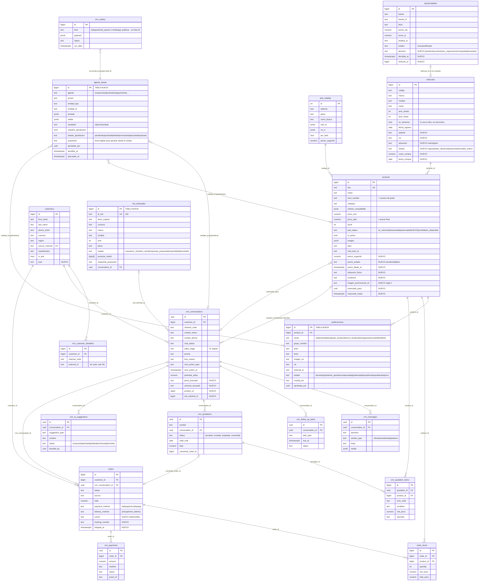

# Fase 1 · Diagrama de relaciones (modelo resultante)

Negro = ya existe. **Negrita en la descripción = columna o tabla nueva de la Fase 1.**
Las tablas `crm_*` de catálogo (etapas, canales, motivos, tipos de tarea) y las de finanzas no se dibujan.

## Vistas en español que leen agentes y dashboard (solo lectura, datos reales)

| Vista | Qué entrega |
|---|---|
| `v_repuestos` | cada repuesto con `estado` unificado (disponible / reservado / vendido / precio_pendiente / disponible_sin_publicar) y `bloqueos_publicacion` (por qué NO se puede publicar: sin_numero_parte, sin_foto, sin_imagen_promocional, precio_pendiente, sin_stock) |
| `v_leads` | las 21 etapas del CRM colapsadas en tus 5 columnas: nuevo → cotizado → seguimiento → cerrado_ganado / cerrado_perdido, más `seguimiento_vencido` |
| `v_ventas` | pedidos pagados + ventas manuales en una sola lista (fecha, total, canal, medio de pago, entrega, seguimiento) |
| `v_inventario_vehiculo` | por auto: piezas totales / disponibles / vendidas / con precio pendiente, valor del stock, **recuperado vs costo_compra** |
| `v_aprobaciones_pendientes` | la cola única: precios pendientes + publicaciones por aprobar + tareas de agentes + sugerencias del CRM |
| `v_equipo_ia` | por agente: última acción, tareas hoy, errores 7 días, esperando aprobación |
